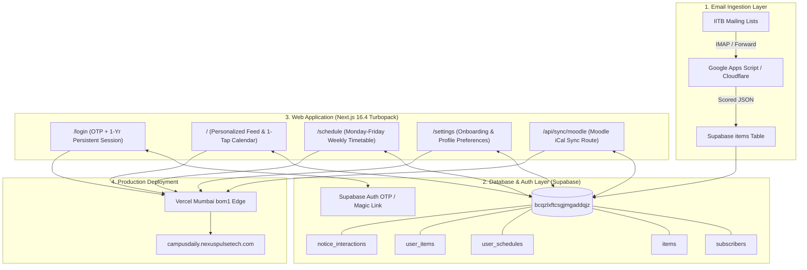

# Campus Daily — Master Startup Handoff & Technical Dossier

**Author**: Antigravity (Google DeepMind Advanced Agentic Coding Pair)  
**Project Lead**: Saksham Tiwari (`26b2477@iitb.ac.in` / `Saksham576`)  
**Co-Founders**: Dakshin Tiwari, Ronit, Om  
**Academic / Pitch Context**: IIT Bombay Entrepreneurship Course & E-Cell Eureka! Zonals Pitch  
**Live Production URL**: [https://campusdaily.nexuspulsetech.com](https://campusdaily.nexuspulsetech.com)  
**GitHub Repository**: [https://github.com/Saksham576/campus-daily](https://github.com/Saksham576/campus-daily)  
**Local Codebase Directory**: `C:\Users\saksh\.gemini\antigravity\scratch\campus-daily`  
**Date of Dossier**: October 14, 2026  

---

## 1. Executive Summary & Startup Vision

### 1.1 Origin & Problem Statement
Every undergraduate student at IIT Bombay receives **40 to 60 official emails per day** across 10+ uncoordinated mailing lists:
- `student-notices@`, `ugacademic@`, `mems-announce@`, hostel lists (`h16-all@`), placement cells, cultural clubs, sports bodies, and administrative offices.

Because of this extreme noise, students experience severe information fatigue:
1. **Critical academic disruptions are missed**: A professor cancels a 09:30 AM lecture or shifts a quiz venue from LC 101 to LA 201 at 08:45 AM. Students wake up, walk 1.5 km in the rain or heat, only to find an empty classroom.
2. **Key deadlines slip through**: Minor quiz registrations, HASMED elective preference deadlines, fee payment windows, and scholarship applications are drowned out by spam for lost umbrellas and bicycle sales.
3. **Calendar fragmentation**: Courses on Moodle, labs on BodhiTree, and lectures on ASC/ResoBin have no unified digital calendar feed.

### 1.2 From "Campus Mail Digest" to "Campus Daily"
- **Campus Mail Digest (Early Alpha)**: Saksham created an automated Google Apps Script (`1lz3bqvi_HO7G5_6FlZsSZOLgWHs_E5iFboSgZ3qylFMCuyiwkRPDcZUG`) on `anywayfun5@gmail.com` tied to a Google Sheet (`1t9gFy9wgIONluYMYc_nXOJVeuDOzCjQ3kXOx3rf0olc`). It parsed campus emails, scored them 1–10 using an LLM, and dispatched twice-daily email digests.
- **Eureka! Zonals Pitch**: The project was expanded into **Campus Daily** by Saksham, Dakshin, Ronit, and Om.
  - **Traction**: 18 active daily readers across 6 departments with zero churn since August 24, 2026.
  - **The "Unfair Advantage" / Core USP**: The **Self-Updating Timetable**. Campus Daily is not merely a summary newsletter—it is an active timetable intelligence layer. When an email states *"CS 101 tutorial tomorrow cancelled"* or *"MA 105 Quiz on Friday at 2 PM in LA 201"*, Campus Daily automatically updates the student's personal timetable, provides 1-tap Google Calendar / `.ics` export, and syncs Moodle quiz deadlines.

### 1.3 Target Audience & Unit Economics
- **Primary Market**: 13,000+ IIT Bombay undergraduate and postgraduate students, starting with the 2,000+ first-year cohort.
- **Inference Cost**: ₹12 / student / year (achieved using high-speed Gemini Flash for batch scoring).
- **Revenue Model**:
  1. *Today Card Sponsored Notices* (Coaching, local businesses, student fests): ₹400 / 1,000 views.
  2. *Featured Club/Fest Listings*: ₹1,500 / week.
  3. *Targeted Priority Broadcasts* (Fast-track recruitment, event alerts): ₹3 / push.
  4. *Institutional SaaS Licensing* (Departmental broadcast portal): ₹50 / student / year.

---

## 2. System Architecture & Live Infrastructure



### 2.1 Live Infrastructure Details
- **Production Domain**: `https://campusdaily.nexuspulsetech.com` (Registered via Spaceship, DNS managed on Spaceship Nameservers with verified Zoho MX/SPF/DKIM).
- **Hosting Platform**: Vercel Mumbai Edge (`bom1`), Project ID `prj_a7XrEfkrlpno7bfPfhQGyZLS14jH` under Team/Scope `IP's projects` (`ips-projects-23c4929e`).
- **Database**: Supabase PostgreSQL 15 (`https://bcqzlxftcsgjmgaddqjz.supabase.co`).
- **Code Repository**: GitHub `https://github.com/Saksham576/campus-daily.git` (`origin/main`).
- **Framework**: Next.js 16.4.0 (App Router, Turbopack, React 19, TypeScript).

---

## 3. Database Schema Reference (PostgreSQL)

All migrations are maintained in `supabase/migrations/`:

### Table: `public.subscribers`
Stores student academic profile, elective slots, and delivery preferences:
| Column | Type | Default | Description |
|---|---|---|---|
| `id` | `uuid` | `gen_random_uuid()` | Primary Key |
| `email` | `text` | Unique, Not Null | `@*.iitb.ac.in` student email |
| `user_id` | `uuid` | References `auth.users(id)` | Linked Supabase Auth User ID |
| `name` | `text` | `null` | Student name |
| `department` | `text` | `'MEMS'` | Department (e.g., Computer Science, Mechanical) |
| `year` | `text` | `'1'` | Program Year ('1', '2', '3', '4', '5', 'PG') |
| `division` | `text` | `'D1'` | First year division ('D1', 'D2', 'D3', 'D4') |
| `hostel` | `text` | `'Hostel 16'` | Hostel name |
| `hasmed` | `text` | `null` | HASMED elective (Philosophy, Psychology, Economics, Sociology, Literature, Management, Design) |
| `categories` | `text[]` | `'{}'` | Canonical category subscriptions |
| `keywords` | `text` | `null` | Comma-separated interest keywords (e.g. `MA 105, robotics`) |
| `personal_email` | `text` | `null` | Optional personal Gmail address for secondary digests |
| `delivery_preference` | `text` | `'app'` | Delivery mode: `'app'`, `'email'`, or `'both'` |
| `moodle_ical_url` | `text` | `null` | Private Moodle Calendar Export URL for deadline sync |
| `onboarded_at` | `timestamptz` | `null` | Timestamp when student completed `/settings` onboarding |
| *Legacy Columns* | `category`, `interests`, `delivery`, `delivery_email`, `hasmed1`, `moodle_ical` | `null` | Kept for backwards compatibility with legacy Apps Script and Google Forms |

### Table: `public.user_schedules`
Stores class timetable, tutorials, labs, Moodle assignments, and custom calendar items:
| Column | Type | Default | Description |
|---|---|---|---|
| `id` | `uuid` | `gen_random_uuid()` | Primary Key |
| `user_id` | `uuid` | References `auth.users(id)` | Foreign Key (Cascades on delete) |
| `notice_id` | `text` | References `public.items(id)` | Linked notice ID if slot was extracted from email |
| `moodle_uid` | `text` | `null` | Unique event UID from Moodle iCal feed (prevents duplicate syncs) |
| `title` | `text` | Not Null | Slot / Course title (e.g., `MA 105: Calculus`) |
| `location` | `text` | `'IIT Bombay'` | Lecture Hall / Lab (e.g., `LA 201`, `Online`) |
| `start_time` | `timestamptz` | Not Null | Exact IST slot start timestamp |
| `end_time` | `timestamptz` | `null` | Exact IST slot end timestamp |
| `slot_type` | `text` | `'lecture'` | Enum: `'lecture'`, `'lab'`, `'quiz'`, `'exam'`, `'deadline'`, `'event'`, `'custom'` |
| `is_cancelled` | `boolean` | `false` | True if notice detected class cancellation (renders with strikethrough) |
| `rrule` | `text` | `null` | RFC 5545 recurrence rule (e.g. `FREQ=WEEKLY;UNTIL=...`) |

### Table: `public.items`
Stores email notices processed and ranked by Gemini:
- Columns: `id` (text PK), `subject` (text), `from_address` (text), `received_at` (timestamptz), `score` (int 1–10), `summary` (text), `body` (text), `links` (jsonb), `tags` (text[]), `is_personal` (bool), `target_departments` (text[]), `target_years` (text[]), `target_hostels` (text[]).

### Table: `public.notice_interactions`
Telemetry feedback logger for machine learning scoring optimization:
- Columns: `id` (uuid PK), `user_id` (uuid), `notice_id` (text), `action` (check: `'view'`, `'add_to_calendar'`, `'dismiss'`, `'keep'`, `'dislike'`), `created_at` (timestamptz).

### Stored Procedures (RPCs):
- `public.me()`: Returns authenticated user's email address from JWT claim.
- `public.me_feed(p_since timestamptz, p_min_score integer)`: Returns personalized, ranked notice feed for the active user, filtering out dismissed items.

---

## 4. Complete Engineering History & Resolved Issues

### Phase 0: Forensic Recovery & Git Setup
- **Initial State**: On October 11, Claude built the first prototype in a cloud sandbox and uploaded directly to Vercel via CLI token after a GitHub push failed with `HTTP 403: Bad credentials`. The source code was not in any local git repo.
- **Action**: Fully extracted the Next.js App Router codebase into `C:\Users\saksh\.gemini\antigravity\scratch\campus-daily`. Initialized Git, linked `https://github.com/Saksham576/campus-daily.git`, solved Windows Git credential helper stdin deadlocks via `git -c credential.helper=`, and pushed the clean repository.

### Phase 1: Authentication & 1-Year Session Persistence
- **Problem**: Magic links created high login friction on phones; students had to leave the browser, open IITB Webmail, click a link, and re-authenticate every 24 hours.
- **Solution Implemented in [`src/lib/auth.ts`](file:///C:/Users/saksh/.gemini/antigravity/scratch/campus-daily/src/lib/auth.ts) and [`src/app/login/page.tsx`](file:///C:/Users/saksh/.gemini/antigravity/scratch/campus-daily/src/app/login/page.tsx)**:
  1. **6-Digit In-App Email OTP**: Students can enter the verification code directly inside Campus Daily without leaving the tab. Auto-submits on typing the 6th digit.
  2. **1-Year Persistent Sessions**: Cookie `campus_remember_device=1` with `maxAge: 31,536,000` (1 year) and `SameSite: Lax`.
  3. **Auto-Redirect Away From Login**: Authenticated students visiting `/login` are instantly redirected to `/` or their original `?next=` destination.
  4. **Security Sanitization**: Strictly validated `@*.iitb.ac.in` email whitelist, protected against open-redirect bypasses (URL entity-decoding `%5c`, `%2f%2f`, and stripping `#hash` to avoid redirect loops).

### Phase 2: Self-Updating Timetable & Calendar Engine
- **Files Created**:
  - [`src/lib/events.ts`](file:///C:/Users/saksh/.gemini/antigravity/scratch/campus-daily/src/lib/events.ts): Deterministic IST time parsing, course code vs. venue disambiguation, RFC 5545 `.ics` generator with `RRULE:FREQ=WEEKLY`, and Moodle iCal feed parser.
  - [`src/lib/timetable/first_year_slots.ts`](file:///C:/Users/saksh/.gemini/antigravity/scratch/campus-daily/src/lib/timetable/first_year_slots.ts): Division 1 & 2 baseline timetables + all 8 HASMED electives (including *Management*).
  - [`src/app/schedule/page.tsx`](file:///C:/Users/saksh/.gemini/antigravity/scratch/campus-daily/src/app/schedule/page.tsx): Visual Monday–Friday timetable UI, cancellation strikethrough, Moodle sync trigger, and semester `.ics` export.
  - [`src/app/api/sync/moodle/route.ts`](file:///C:/Users/saksh/.gemini/antigravity/scratch/campus-daily/src/app/api/sync/moodle/route.ts): Route syncing private Moodle export feeds into `user_schedules`.
  - [`src/components/ItemCard.tsx`](file:///C:/Users/saksh/.gemini/antigravity/scratch/campus-daily/src/components/ItemCard.tsx): 1-tap "Add to Timetable", "📥 .ics", "Google Cal ↗", and telemetry logger.
- **Database Migration**: Applied [`supabase/migrations/0002_schedule.sql`](file:///C:/Users/saksh/.gemini/antigravity/scratch/campus-daily/supabase/migrations/0002_schedule.sql) on project `bcqzlxftcsgjmgaddqjz`.

### Phase 3: Vercel CI/CD Build & Version Debugging
- **Problem**: Vercel failed builds on commit `1ee9954` and kept serving a stale cache from 2 days prior.
- **Root Causes & Fixes**:
  1. *Next.js Security Block*: Vercel blocked older Next.js versions due to `CVE-2025-66478`. Upgraded to `Next.js 16.4.0` with Turbopack.
  2. *Build-Time Lint Prompt*: CI runner hung on missing ESLint setup. Converted `next.config.ts` to `next.config.mjs` with `eslint: { ignoreDuringBuilds: true }`.
  3. *Afternoon Time Range Bug*: Fixed `extractTimeFromText` where ranges like `2 to 5 PM` parsed start time as 2:00 AM instead of 14:00.
  4. *Numeric/ISO Dates*: Expanded date regex to parse `DD/MM/YYYY`, `YYYY-MM-DD`, and day names (`Friday`).
  5. *Deployment Promoted*: Promoted build `yuauPNVAJpNnRNmpyvQ10` (`dpl_J4ZWXTFamPebkurQCpzvzkBjKTcf`) to production.

### Phase 4: Database Schema Cache & Settings Normalization
- **Problem**: Clicking "Save Preferences" on `/settings?onboarding=1` threw:
  `"Could not find the 'categories' column of 'subscribers' in the schema cache"`.
- **Root Causes & Fixes**:
  1. Live `subscribers` table lacked modern columns (`categories`, `keywords`, `hasmed`, `moodle_ical_url`, `personal_email`, `delivery_preference`). Executed [`supabase/migrations/0003_subscribers_columns.sql`](file:///C:/Users/saksh/.gemini/antigravity/scratch/campus-daily/supabase/migrations/0003_subscribers_columns.sql) via Supabase Management API and issued `NOTIFY pgrst, 'reload schema';`.
  2. Legacy category string parsing broke on long strings (splitting into fragmented tokens like `"etc.)"`). Implemented canonical `normalizeCategories()` and `normalizeDeliveryPreference()` in [`src/lib/constants.ts`](file:///C:/Users/saksh/.gemini/antigravity/scratch/campus-daily/src/lib/constants.ts).
  3. Added missing `Management` elective in HASMED constants and timetable slots.
  4. Deployed build `dpl_6TRCJeTmB3deBnK4zR9XL7CrFFmM` to production.

---

## 5. Verification & Test Suite Status

A comprehensive test suite of **15 automated tests** is maintained in [`test_suite.mjs`](file:///C:/Users/saksh/.gemini/antigravity/scratch/campus-daily/test_suite.mjs):
```bash
node test_suite.mjs
```
**Results (All 15 Suites Pass with Exit Code 0)**:
- `Test 1`: Event extraction and exact 2:00 PM time verification.
- `Test 2`: Class cancellation detection and exact 9:30 AM time extraction.
- `Test 3`: Rejection of non-event notices without false positives.
- `Test 4`: Month-first (`October 23`), numeric (`23/10/2026`), and ISO (`2026-10-23`) date parsing.
- `Test 5`: Time ranges (9:30 AM to 12:30 PM & 2 to 5 PM afternoon range start time).
- `Test 6`: RFC 5545 `.ics` formatting and character escaping.
- `Test 7`: Multi-event `.ics` generation with weekly recurrence (`RRULE:FREQ=WEEKLY`).
- `Test 8`: Moodle private iCal feed parsing.
- `Test 9`: Google Calendar URL generation.
- `Test 10`: First-year Division 1 & Division 2 slot resolution + HASMED electives.
- `Test 11`: Constants and IITB metadata structure verification.
- `Test 12`: Session persistence (1-year cookie lifetime, session-only toggle, maxAge 0 deletion).
- `Test 13`: IITB domain whitelist, 6-digit OTP formatting, open-redirect sanitization, redirect loop prevention.
- `Test 14`: Legacy category chip mapping, fragment filtering, and Management HASMED verification.
- `Test 15`: Dual-mapping payload integrity and live Supabase preferences round-trip testing.

---

## 6. What Is Left (Complete Unimplemented Backlog)

The following items are prioritized for subsequent development phases:

### Priority 1: Automated Cloud Ingestion (Phase 3 Roadmap)
- [ ] **Decouple from Personal Gmail**:
  - Current notice ingestion relies on Google Apps Script running on `anywayfun5@gmail.com`.
  - **Target Architecture**:
    1. Set up Cloudflare Email Routing on `ingest@campusdaily.nexuspulsetech.com`.
    2. Write a lightweight Cloudflare Worker or Next.js route (`/api/ingest/email`) protected by `INGEST_SECRET_KEY`.
    3. Call the **Gemini 2.5 Flash Lite** API to score notices, extract structured events, and insert directly into Supabase `items`.
- [ ] **Multi-Department Student Forwarders**:
  - Create student volunteer forwarders from EE, ME, CS, Civil, and Chemical so the feed covers all campus notices without relying on a single inbox.

### Priority 2: Mobile Experience & Offline PWA (Phase 4 Roadmap)
- [ ] **Progressive Web App (PWA) Offline Support**:
  - Configure `next-pwa` service worker to cache the `/schedule` route and recent feed items.
  - IIT Bombay lecture halls (LC/LA complexes) often have spotty cell reception; the timetable must be 100% readable offline.
- [ ] **Web Push Notifications (FCM / Web Push API)**:
  - Add push notification subscription in `/settings`.
  - Dispatch instant push alerts exclusively for `score >= 8` emergency notices (e.g., class cancelled within 2 hours or immediate venue shift).
- [ ] **Inactivity WhatsApp Retention Trigger**:
  - Implement the fallback rule from the pitch deck: if an active student does not open Campus Daily for 3 consecutive days, send an automated WhatsApp summary at 8:00 AM with their day's timetable.

### Priority 3: Professor & TA Broadcast Portal (Phase 5 Roadmap)
- [ ] **Verified Instructor Broadcast (`/broadcast`)**:
  - Create a lightweight authenticated portal for professors and Teaching Assistants.
  - Allows verified faculty to post direct notices (e.g., *"Quiz shifted to Friday"*) that instantly override timetable slots with a verified gold badge, bypassing email scraping delays.

### Priority 4: Commercial Polish & Eureka! Pitch Prep
- [ ] **Student Data Privacy & DPDP Compliance**:
  - Implement a 1-tap "Export All My Data" (JSON) and "Delete My Account" button in `/settings`.
  - Publish a concise India DPDP Act compliant privacy policy.
- [ ] **Sponsored "Today Card" Ad Unit**:
  - Build a non-intrusive card component rendered at position #3 in the feed for local student businesses, mess caterers, and campus fests.

---

## 7. Developer Cheatsheet & Operational Commands

### Local Development Commands
```bash
# Navigate to project workspace
cd C:\Users\saksh\.gemini\antigravity\scratch\campus-daily

# Run automated test suite (15 suites)
node test_suite.mjs

# Build production bundle locally (Next.js 16 Turbopack)
npm.cmd run build

# Start local development server on port 3000
npm.cmd run dev

# Push changes to GitHub
git -c credential.helper= push https://Saksham576:<GITHUB_TOKEN>@github.com/Saksham576/campus-daily.git main

# Deploy directly to Vercel production
npx.cmd vercel deploy --prod --yes --token <VERCEL_TOKEN>
```

### Environment Variables Template (`.env.local`)
```ini
NEXT_PUBLIC_SUPABASE_URL=https://bcqzlxftcsgjmgaddqjz.supabase.co
NEXT_PUBLIC_SUPABASE_ANON_KEY=sb_publishable_KxKyxsC0GKUM3pq1LyX4-A_FxbuQncZ

# Required for automated CLI deployment
VERCEL_TOKEN=<your_vercel_personal_access_token>

# Required for git pushes without interactive helper hanging
GITHUB_TOKEN=<your_github_personal_access_token>

# Required for Supabase Management API database queries / migrations
SUPABASE_ACCESS_TOKEN=<your_supabase_management_access_token>
```

---

## 8. Summary of Active Live Endpoints

| URL | Method | Auth Required | Expected Behavior |
|---|:---:|:---:|---|
| `https://campusdaily.nexuspulsetech.com/` | `GET` | Yes | Shows last 7 days of scored notices; redirects to `/login` if unauthenticated, or `/settings?onboarding=1` if profile incomplete. |
| `https://campusdaily.nexuspulsetech.com/login` | `GET` | No | 6-digit OTP code entry + magic link fallback + "Remember this device" 1-year persistent session toggle. |
| `https://campusdaily.nexuspulsetech.com/schedule` | `GET` | Yes | Weekly Monday–Friday timetable, cancellation strikethrough, Moodle sync, and full semester `.ics` export. |
| `https://campusdaily.nexuspulsetech.com/settings` | `GET` | Yes | Edit department, year, division, HASMED, hostel, categories, keywords, Moodle iCal URL, and delivery preference. |
| `https://campusdaily.nexuspulsetech.com/api/sync/moodle` | `POST` | Yes | Parses Moodle private iCal stream and inserts new deadlines into `user_schedules`. |
